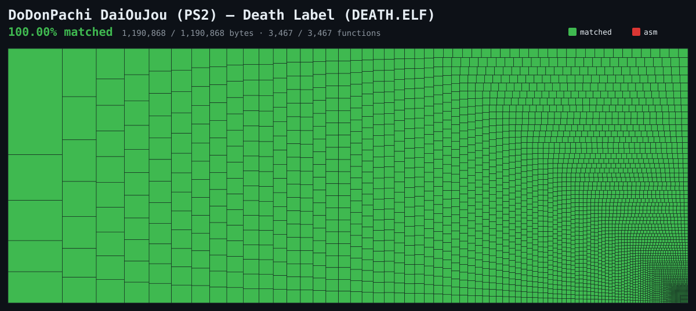
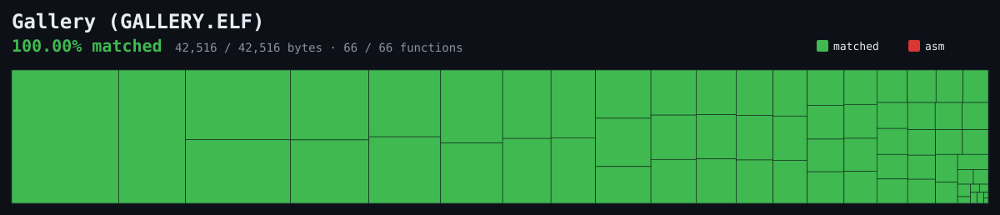

# DoDonPachi DaiOuJou Decompilation (PS2)

Byte-matching decompilation of **DoDonPachi DaiOuJou** (PS2), covering all three disc executables: the main game (`SLPS_252.33`), Death Label (`DEATH.ELF`), and the Gallery (`GALLERY.ELF`). No game assets or binaries are included; supply your own retail ISO to build.

[](docs/progress-map-main.svg)

[](docs/progress-map-death.svg)

[](docs/progress-map-gallery.svg)


## Building

Requires [uv](https://docs.astral.sh/uv/) and a retail ISO of **DoDonPachi DaiOuJou** (`SLPS-252.33`). Setup automatically downloads and verifies the compilers, PS2 binutils, and runner.

### macOS

```sh
brew install uv zstd
uv run tools/setup.py --iso /path/to/ddpdoj.iso --build
```

*(Apple Silicon uses Rosetta 2 for `wibo`, or a local x86 QEMU guest if `qemu-system-x86_64` is installed.)*

### Windows

```powershell
winget install astral-sh.uv
uv run tools/setup.py --iso C:\path\to\ddpdoj.iso --build
```

*(CodeWarrior runs natively on Windows.)*

### Linux (x86-64)

Requires `glibc >= 2.38` and `libzstd` (e.g. `sudo apt install libzstd1`).

```sh
curl -LsSf https://astral.sh/uv/install.sh | sh
uv run tools/setup.py --iso /path/to/ddpdoj.iso --build
```

### Subsequent builds

```sh
# Rebuild and SHA-256 verify all three ELFs (SLPS_252.33, DEATH.ELF, GALLERY.ELF)
uv run tools/build.py

# Build a single target
uv run tools/build.py --target SLPS_252.33

# Build shiftable mod ELFs and repack build/mod/ddpdoj.iso
uv run tools/build.py --mod --iso
```

